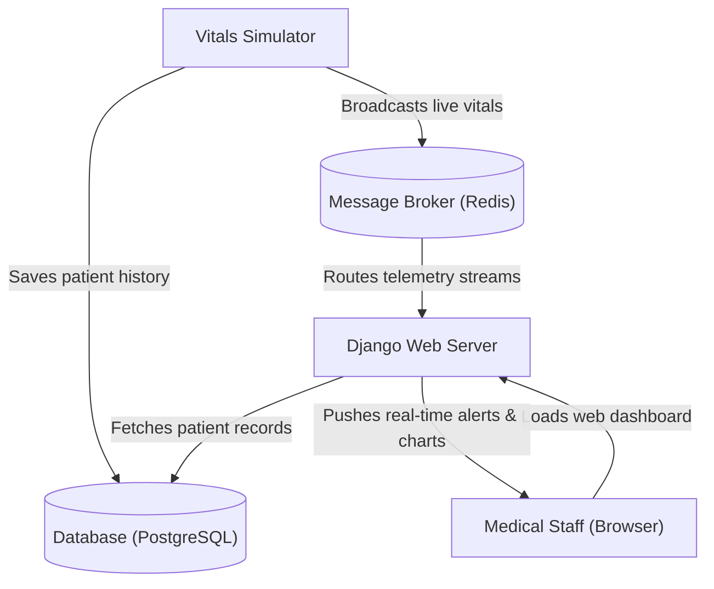

<div align="center">
    
    <p><strong>HealthTrack: </strong>Real-time hospital patient monitoring with clinical anomaly detection.<br>Written in Python/Django</p>
    <a href="https://github.com/KafetzisThomas/HealthTrack/releases">
        
    </a>
</div>

## Description

A hospital patient monitoring platform that simulates patient vital signs, detects anomalies against clinical standards
and notifies medical staff with live warning and critical indicators.

## Features

- [X] Manage **patient admissions** and medical records with **last name search**
- [X] Generate **continuous vital signs** (Heart Rate, SpO₂, Temperature, Respiratory Rate, Blood Pressure) tailored to individual physiological profiles
- [X] Evaluate clinical deterioration risk using authentic **NEWS2 scoring**
- [X] Track vital sign trends through **real-time telemetry charts** and **historical measurement logs**
- [X] Receive **instant audio alerts** for abnormal vital signs, single beep for **warning**, double beep for **critical**
- [X] Brute force login protection with **rate limiting**

## System Architecture



## Database Schema


## Usage

First install `uv` and sync the project dependencies:

```bash
cd path/to/root/directory
pip install uv
uv sync
uv sync --group dev  # for devs only
```

Migrate database:

```bash
uv run manage.py migrate
```

Create a superuser for admin and creating accounts/doctors:

```bash
uv run manage.py createsuperuser
```

Start Redis server:

```bash
docker run -d --name redis -p 6379:6379 redis
```

Run the simulator:

```bash
uv run manage.py simulate
uv run manage.py simulate --interval 5  # secs between measurement rounds
```

Run ASGI/Daphne server:

```bash
uv run manage.py runserver
```

Access web application at `http://127.0.0.1:8000` or `http://localhost:8000`.

## Demo Images


## Demo Videos

https://github.com/user-attachments/assets/ff1510b3-ee29-45e3-b5ed-985784c90a91

https://github.com/user-attachments/assets/cb9711dc-8c4a-43e9-bce2-85ca8def8f62

https://github.com/user-attachments/assets/db50159f-01da-4bee-b05c-be080af7fd04

https://github.com/user-attachments/assets/232882cf-93c7-4ef9-a40c-cb64161b42e0

https://github.com/user-attachments/assets/71f3a5cd-bf79-49ac-9308-8fae4ceb650a
