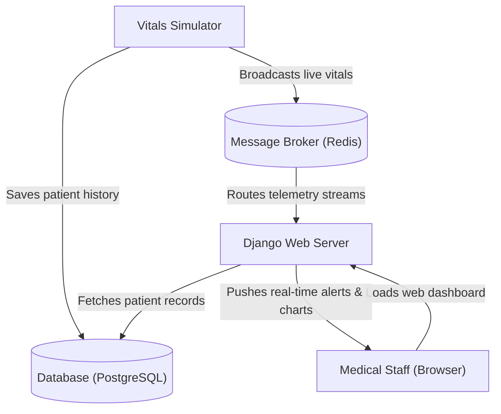
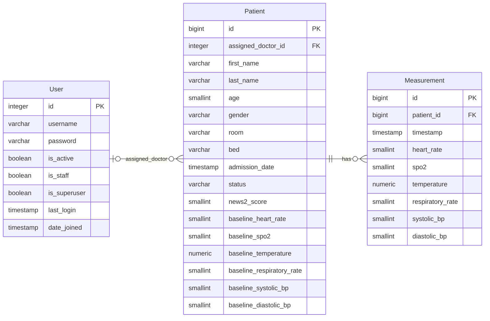

<div align="center">
    
    <p><strong>HealthTrack: </strong>Real-time hospital patient monitoring with clinical anomaly detection.<br>Written in Python/Django</p>
    <a href="https://github.com/KafetzisThomas/HealthTrack/releases">
        
    </a>
</div>

## Description

A hospital patient monitoring platform that simulates patient vital signs, detects anomalies against clinical standards
and notifies medical staff with live warning and critical indicators.

## Features

- [X] Manage **patient admissions** and medical records with **last name search**
- [X] Generate **continuous vital signs** (Heart Rate, SpO₂, Temperature, Respiratory Rate, Blood Pressure) tailored to individual physiological profiles
- [X] Evaluate clinical deterioration risk using authentic **NEWS2 scoring**
- [X] Track vital sign trends through **real-time telemetry charts** and **historical measurement logs** with live stream **pause controls** and **column sorting**
- [X] Receive **instant audio alerts** for abnormal vital signs, single beep (440Hz) for **warning**, double beep (880Hz) for **critical** with per-patient **mute controls**
- [X] Brute force login protection with **rate limiting**

## System Architecture



## Database Schema



## Usage

First install `uv` and sync the project dependencies:

```bash
cd path/to/root/directory
pip install uv
uv sync

# for devs only
uv sync --group dev
uv run pre-commit install
```

Start PostgreSQL and Redis services:

```bash
docker compose up -d
```

Migrate database:

```bash
uv run manage.py migrate
```

Create a superuser for admin and creating accounts/doctors:

```bash
uv run manage.py createsuperuser
```

Run the simulator:

```bash
uv run manage.py simulate
uv run manage.py simulate --interval 5  # secs between measurement rounds
```

Run ASGI/Daphne server:

```bash
uv run manage.py runserver
```

Access web application at `http://127.0.0.1:8000` or `http://localhost:8000`.

## Demo Images


## Demo Videos

> [!NOTE]
> Click unmute on the video player to hear the audio alerts (GitHub mutes playback by default).

https://github.com/user-attachments/assets/10c4dbca-ff13-45c1-bdcd-68bde251c054

https://github.com/user-attachments/assets/86c8c815-edda-4d05-8b02-fc7120ca3dc7

https://github.com/user-attachments/assets/612e82a0-e62a-47db-9363-27517fecfeac

https://github.com/user-attachments/assets/232882cf-93c7-4ef9-a40c-cb64161b42e0

https://github.com/user-attachments/assets/82666800-146b-47e3-9ca0-855239eb0e33
